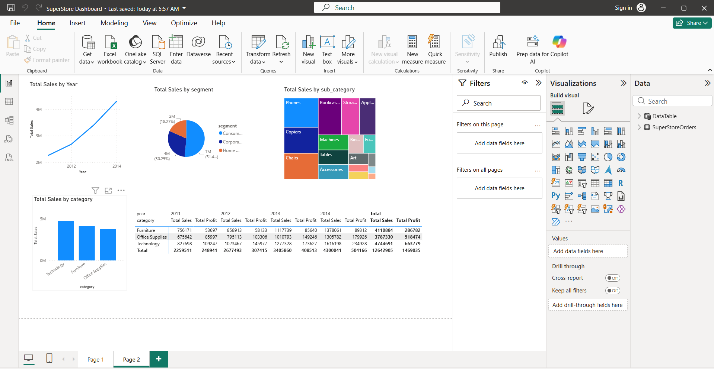
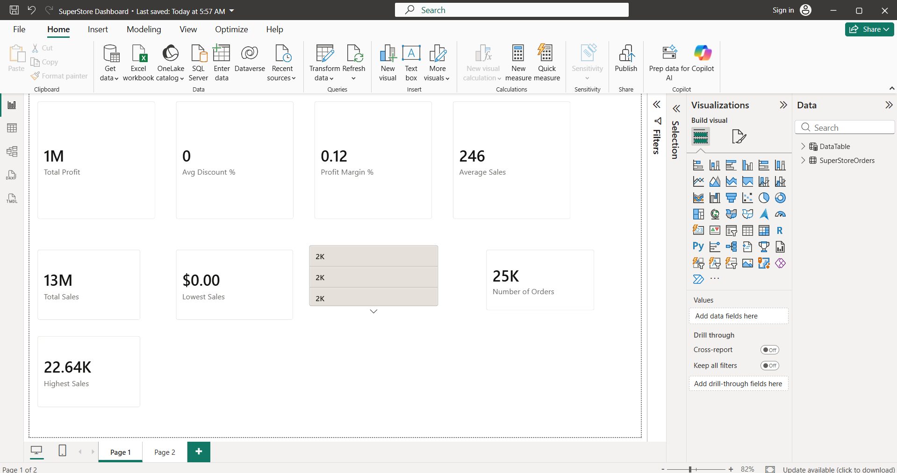

# Superstore Sales Dashboard (Power BI)

An interactive Power BI dashboard analysing the Superstore Sales dataset (about 51,000 order lines, 2011 to 2014, global markets). Built for CIT308 Data Visualization, BAIT, SLTC Research University.

## Dashboard preview
   
   

## Files

| File | Description |
|---|---|
| `SuperStore_Dashboard.pbix` | Power BI report (open with Power BI Desktop) |
| `SuperStoreOrders.csv` | Source dataset |
| `Report.pdf` | Project report covering each step |
| `screenshots/` | Dashboard screenshots |

## What was done

1. **Import**: loaded the CSV with Get Data, then checked and corrected column data types (dates, decimals, whole numbers).
2. **Cleaning (Power Query)**: fixed data types, handled null/blank values, added `Month Name` and `Days to Ship` (ship date minus order date).
3. **Data model**: created a Date table (`DataTable`) with DAX `CALENDAR()`, marked it as a date table, and related it one-to-many to `SuperStoreOrders` on `order_date`. This supports Year > Quarter > Month > Date drill-down.
4. **DAX measures**: Total Sales, Total Profit, Average Sales, Number of Orders, Profit Margin %, Highest Sales, Lowest Sales, Avg Discount %.
5. **Visuals**: KPI cards, bar chart (sales by category), line chart (sales by year), donut chart (sales by segment), treemap (sales by sub-category).
6. **Interactivity**: cross-filtering between visuals, tooltips, drill down, and a Year slicer.
7. **Design**: one theme for colours and fonts, titles on every visual, KPI cards in a single row at the top.

## Key insights

- Sales grow every year: about 2.26M (2011), 2.68M (2012), 3.41M (2013), 4.30M (2014).
- The Consumer segment gives the largest share of sales, about 51%.
- Technology is the top category by both sales and profit.
- A few sub-categories (Phones, Copiers, Chairs) account for a large share of revenue.

## Tech

Power BI Desktop, Power Query, DAX

## Author

MM Fathima Sumla
